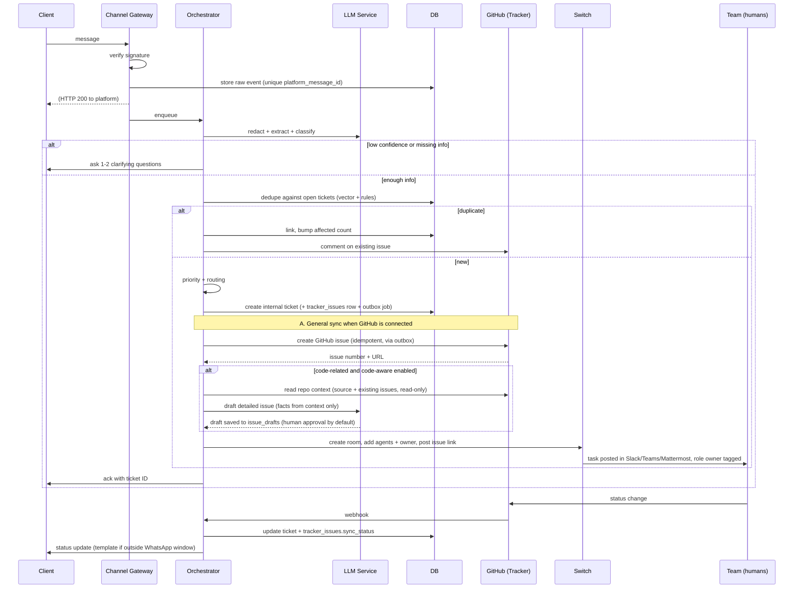

# Client Complaint Automation Platform — System Architecture

| | |
|---|---|
| **Status** | Draft v1.1 — adds general GitHub ticket synchronization and separates it from code-aware issue generation |
| **Last updated** | 2026-11-04 |
| **Context** | Built for the *Flip the Switch* hackathon (Nov 4–7, 2026), designed to outlive it |
| **Core dependency** | [Switch](https://github.com/sandbox-quantum/switch) (agents + team chat rooms) |

> **Implementation status (verified 2026-11-04).** The project repository
> (`/home/rahul/relay`) currently contains this architecture document only; no application
> code, schema, migrations, or configuration has been committed yet. Everything below is
> therefore **planned**, except where a section is explicitly marked *implemented*. The
> engineering breakdown in [`issues.md`](./issues.md) reflects this greenfield state.
>
> Legend used throughout:
> - **Implemented** — exists and works today.
> - **Planned** — required for the hackathon demo (P0/P1 in `issues.md`).
> - **Optional / stretch** — not required for the demo; build only if time allows.

---

## 1. Purpose

A client complains on **WhatsApp or Telegram**. An LLM understands the complaint, then the platform automatically:

1. creates a **ticket** in the team's tracker (Jira / GitHub Issues / Linear),
2. opens a **task/room** in the team's chat app (Slack / Teams / Mattermost / Discord) via Switch,
3. **notifies the right role** (designer, developer, tester, product manager),
4. assigns a **priority**,
5. keeps the **client informed** until the issue is resolved.

A **web frontend** lets an admin register bots, connect chat apps and trackers, define team members and routing rules, and watch tickets.

### Goals
- End-to-end flow from client message to assigned, prioritized ticket with no human in the loop for the happy path.
- Humans stay in control of anything risky: customer-facing replies on high severity, code changes, deploys.
- Never lose a message. Degrade to a human queue instead of failing silently.
- Multi-tenant data model from day one, even if the demo runs one tenant.

### Non-goals (v1)
- A general-purpose assistant for clients (also forbidden on WhatsApp, see §2).
- Replacing the ticket tracker or the chat apps.
- Voice calls, email intake, SLA contract management.

---

## 2. Platform facts that shape the design (verified Nov 2026)

These are the constraints from the latest platform changes. Several differ from older tutorials, so they are listed explicitly.

| Platform | Current fact | Design consequence |
|---|---|---|
| **WhatsApp Business Platform** | Per-message pricing since Jul 1, 2025 (replaced conversation-based). From **Oct 1, 2026**, in-window service messages are billed after a **1,000 free/month per phone number** allowance, per Meta-partner coverage. Non-template messages only inside a 24h customer service window; templates required outside it. 72h free-entry-point windows exist. | Budget outbound messages. Batch status updates, use approved **templates** for out-of-window updates, track per-tenant message cost. **Verify exact rates on Meta's pricing page** before launch, because partner sources disagree on utility-template treatment. |
| **WhatsApp AI policy** | Since **Jan 15, 2026**, general-purpose AI assistants are banned on the Business API. Task-specific support and triage bots are allowed. | The bot must be scoped to complaints, status and FAQs. No open-ended chat. Refuse and redirect off-topic requests. |
| **Telegram Bot API** | Webhooks and `getUpdates` are mutually exclusive. Webhook ports: 443, 80, 88, 8443. Webhook supports a `secret_token` sent as `X-Telegram-Bot-Api-Secret-Token`. Messages max 4,096 chars. Guideline limits: ~1 msg/s per chat, 20 msg/min per group, ~30 msg/s bulk. A bot cannot message a user first. Latest API version reported as 10.2 (July 2026). | Use webhooks with secret-token validation. Queue outbound sends with per-chat throttling and 429 backoff. Chunk long replies. |
| **MCP** | Current spec is **2026-07-28**: stateless core (no `initialize`, no `Mcp-Session-Id`), per-request version header, OAuth 2.1 resource-server auth, Tasks moved to an official extension, Roots/Sampling/Logging deprecated. | Build any MCP servers we write against 2026-07-28. Check that Switch's agent plugins and our SDK version support it. Keep tool auth OAuth-based. |
| **Slack** | Commercially distributed apps not in the Marketplace get **1 req/min, 15 objects** on `conversations.history`/`replies` (existing installs since Mar 3, 2026). Internal single-workspace apps keep normal limits. Marketplace is the only channel for commercial distribution. Classic apps deprecation date pushed to Nov 16, 2026. | For a multi-tenant SaaS, either pass Marketplace review or have each customer create an **internal app** (bring-your-own-app). Avoid polling history. Use Events API and keep our own copy of messages. |
| **Microsoft Teams** | Bot Framework SDK is archived and unsupported after Dec 31, 2025. Use **Teams SDK** (Teams-only) or **Microsoft 365 Agents SDK** (multi-channel). TeamsFx deprecated. | Do not write a Teams adapter on Bot Framework. Prefer Switch's Teams bridge. If custom, use the Teams SDK. |
| **Switch** | Core = Matrix homeserver (Tuwunel) + PostgreSQL + Agent Bridge (HTTP in, SSE out, MCP) + Collaboration Bridge (Slack, Teams, Discord, Telegram, Mattermost) + Room Service + Gateway API. Gateway UI on port 3000, agent API on 8000, agents register with `AGENT_REGISTRATION_TOKEN`. **No WhatsApp bridge.** License is Apache 2.0 + Commons Clause. | WhatsApp is our own adapter. Switch handles team-side rooms and agents. We cannot resell Switch itself. |

> **Unverified assumptions about Switch** (confirm on day 1 via `docs.flintai.dev`, also served over MCP at `https://docs.flintai.dev/mcp`):
> 1. The Gateway API lets us create rooms and add participants programmatically.
> 2. Rooms can be bound to a specific Slack/Mattermost channel on creation.
> 3. Per-room permissions can restrict which agents may talk to which participants.
> 4. Webhooks or SSE events are available for room task state changes.
>
> If (1) is false, fall back to a fixed set of pre-created rooms per category and post tasks into them.

---

## 3. High-level architecture

```mermaid
flowchart LR
  subgraph Clients
    WA[WhatsApp client]
    TG[Telegram client]
  end

  subgraph Platform["Our platform"]
    GW[Channel Gateway<br/>webhooks + signature check]
    Q[(Queue<br/>Redis Streams / SQS)]
    ORCH[Orchestrator<br/>workflow engine]
    LLM[LLM Service<br/>extract / classify / dedupe]
    PRI[Priority + Routing Engine]
    OUT[Outbox Dispatcher]
    DB[(PostgreSQL + pgvector)]
    API[Admin API]
    UI[Admin Frontend]
  end

  subgraph Switch["Switch Core"]
    GWAPI[Gateway API]
    ROOMS[Rooms / Matrix]
    AB[Agent Bridge HTTP+SSE+MCP]
    CB[Collaboration Bridge]
  end

  subgraph Team["Team side"]
    SL[Slack / Teams / Mattermost / Discord]
    TR[Tracker: Jira / Linear<br/>(stretch)]
    GH[GitHub Issues<br/>general sync + code-aware]
  end

  WA --> GW
  TG --> GW
  GW --> Q --> ORCH
  ORCH --> LLM
  ORCH --> PRI
  ORCH --> DB
  ORCH --> OUT
  OUT --> TR
  OUT --> GH
  OUT --> GWAPI --> ROOMS
  ROOMS <--> CB <--> SL
  ROOMS <--> AB
  AB --> AGENTS[Switch agents<br/>triage / repro / notifier]
  AGENTS --> TR
  AGENTS --> GH
  OUT --> GW
  UI --> API --> DB
  API --> GWAPI
```

### Design principles
1. **Acknowledge fast, process async.** Webhooks return 200 immediately after persisting the raw event. All work happens off a queue.
2. **Persist before acting.** The raw inbound event is stored before any LLM call, so nothing is lost.
3. **Idempotent everywhere.** Platform message IDs are unique keys. Every outbound side effect uses an idempotency key.
4. **Outbox for side effects.** Ticket creation, room creation and client messages go through a transactional outbox with retry and reconciliation.
5. **Untrusted input.** Client text is data, never instructions. The customer-facing agent has no tools beyond "reply" and "escalate".
6. **Rules set the floor, LLM adds nuance.** Priority and routing are deterministic first, LLM-adjusted second, human-overridable always.
7. **One GitHub integration, two capabilities.** General ticket synchronization and code-aware issue generation share a single provider, transactional outbox and idempotency layer so they can never open two issues for one ticket (§4.10).

---

## 4. Components

### 4.1 Channel Gateway
Receives inbound webhooks and sends outbound messages. One adapter per channel behind a common interface.

```ts
interface ChannelAdapter {
  verifyRequest(req): boolean                 // signature / secret-token check
  parseInbound(req): NormalizedMessage[]      // platform payload -> common shape
  send(botId, conversationId, content): SendResult
  fetchMedia(ref): Buffer                     // download attachments
  healthCheck(botId): HealthStatus
}
```

| Adapter | Inbound | Verification | Outbound | Notes |
|---|---|---|---|---|
| Telegram | Webhook per bot | `X-Telegram-Bot-Api-Secret-Token` equals per-bot secret | `sendMessage`, `sendDocument` | Register webhook with `setWebhook`, set `allowed_updates`. Ack within seconds. |
| WhatsApp | Webhook from Meta Cloud API | `X-Hub-Signature-256` HMAC with app secret, plus verify-token handshake | Free-form in 24h window, templates outside | Multi-tenant onboarding via Meta **Embedded Signup** (verify current requirements, needs Tech Provider status). Use the Meta test number or Twilio sandbox for the hackathon. |

`NormalizedMessage`:
```json
{
  "tenantId": "t_1", "botId": "b_1", "channel": "telegram",
  "platformMessageId": "…", "platformChatId": "…", "senderRef": "…",
  "text": "…", "attachments": [{"type":"image","ref":"…","mime":"image/png"}],
  "receivedAt": "2026-11-04T09:00:00Z", "replyTo": null
}
```

### 4.2 Queue
Redis Streams (hackathon) or SQS/Kafka (production). Consumer groups per stage. Dead-letter stream for poison messages. Per-conversation ordering via partition key `conversationId`.

### 4.3 Orchestrator (workflow engine)
A durable state machine per inbound message/conversation. Use **Temporal** if the team knows it, otherwise a simple Postgres-backed job runner (`pg-boss` / `BullMQ`). Responsibilities:
- run pipeline stages in order with retries and timeouts,
- persist each step's result,
- resume after crashes,
- schedule SLA timers and escalations.

### 4.4 LLM Service
Wraps model calls with structured output, validation, redaction and fallbacks. Details in §7.

### 4.5 Priority + Routing Engine
Pure functions over (extracted fields, client profile, tenant rules, open tickets). Details in §8.

### 4.6 Outbox Dispatcher
Reads `outbox` rows and performs side effects against the tracker (including `github.create_issue` / `github.update_issue`), the Switch Gateway API, and channel adapters. Retries with exponential backoff, marks done, and a reconcile job compares tracker/Switch state with DB state.

### 4.7 Switch Integration Layer
- **Gateway API client**: create room, add participants, set instructions, attach knowledge, bind chat channel.
- **Agents** (registered via the Agent Protocol or Switch Console):
  - `triager`: summarizes and routes inside the room.
  - `repro`: writes the smallest reproduction for bugs and posts output.
  - `notifier`: pings role owners and follows up on silence.
  - `client-liaison`: the only agent allowed to draft client-facing replies. Drafts require human approval for P1/P2.
- Agents run via Switch Console (Claude Code / Codex / OpenCode) or as custom agents on the HTTP+SSE protocol.

### 4.8 Tracker Integration
Behind a `TrackerProvider` interface: `createIssue`, `updateIssue`, `addComment`, `linkIssues`, `getStatus`, `onWebhook`. Implement **GitHub Issues first** (simplest auth), then Jira and Linear. Where an MCP server exists, agents use it. Our orchestrator calls provider APIs directly for determinism.

GitHub carries **two complementary capabilities**, both built on the same provider, outbox and idempotency infrastructure (see §4.10):

- **A. General GitHub ticket synchronization** — every ticket raised while GitHub is connected and configured gets a corresponding issue. Applies to all categories (bug, feature, billing, question, other) and performs no repository source analysis.
- **B. Code-aware GitHub issue generation** — for genuinely code-related complaints, retrieve repository context and generate a technically detailed issue, with duplicate detection and human approval.

Jira and Linear reuse the same `TrackerProvider` interface but remain **optional / stretch** and are out of scope for the hackathon demo.

### 4.9 Admin API + Frontend
REST (or tRPC) over the same Postgres. Details in §9 and §10.

### 4.10 GitHub Issue Generation

GitHub is the primary tracker for the hackathon. Issue generation is delivered as **one shared
pipeline with two modes** so that general synchronization and code-aware generation never diverge
and never create two issues for the same ticket.

**Shared infrastructure (both modes):**
- The `GitHubProvider` implementation of `TrackerProvider` (§4.8), holding the tenant's token as a
  secret reference.
- A transactional **outbox** kind `github.create_issue` (§4.6), so a tracker outage never loses or
  blocks an internal ticket.
- An **idempotency key** `github:{tenantId}:{ticketId}:{mode}` persisted in `tracker_issues` under a
  unique constraint, so a retry or a duplicate pipeline run cannot open a second issue.
- A `tracker_issues` row linking the internal ticket to the external issue (number, URL, repo, sync
  status, mode, last error).
- The same reconcile job (§4.6) that compares local state with GitHub and repairs drift.

#### 4.10.1 A. General GitHub Ticket Synchronization
Triggered for **every** newly created ticket when a GitHub integration exists for the tenant with
`status = active` and a `repo_ref` selected. This is the default capability and requires no
repository source analysis.

1. The orchestrator creates the internal ticket and, in the **same DB transaction**, enqueues an
   outbox `github.create_issue` row carrying the idempotency key above.
2. The outbox dispatcher calls `GitHubProvider.createIssue` with a body assembled from the ticket:
   - ticket title and problem description (`summary`),
   - priority and category,
   - customer impact (client tier + `affected_client_count`),
   - reproduction steps, expected vs actual, when extraction produced them,
   - relevant evidence (media / transcript references),
   - acceptance criteria when present.
3. On success: write `tracker_issues` (external number/URL/repo, `sync_status = created`), set
   `tickets.tracker_ref`, append a `ticket_events` row, and surface the link in the admin dashboard
   and the Switch room (§4.7).
4. Labels come from the tenant's `integrations.label_map_json` (category + priority → labels).
5. Approval policy: general sync follows the tenant's `integrations.approval_policy`
   (`auto` = create immediately, `human` = stage for approval). Default for the demo: `auto`.

**Failure handling:** any GitHub error (auth, rate limit, 5xx, timeout) leaves the internal ticket
untouched and sets `tracker_issues.sync_status = failed`; the outbox retries with exponential
backoff and the reconcile job repairs drift. A ticket is never lost or blocked by GitHub.

#### 4.10.2 B. Code-aware GitHub Issue Generation
Applies only to complaints classified as code-related (e.g. `category = bug` with a resolvable
product area / repo) and only when the tenant sets `code_aware_enabled`. It **extends** general
synchronization: it reuses the same provider, outbox, idempotency key and `tracker_issues` row — a
ticket already synchronized in mode `general` is never issued a second time; the code-aware result
updates/enriches the existing issue or is staged as a draft.

1. Retrieve repository context for the referenced repo: relevant source files, documentation,
   open/closed issues and recent commits (GitHub API, read-only).
2. Feed **only** the ticket's extracted facts plus the retrieved context to the stronger LLM tier
   (§7.1). The model may cite only facts present in that context; it must not invent file names,
   functions, versions or steps.
3. Produce a `github.draft.v1` object stored in `issue_drafts`: title, detailed description,
   suspected area/files (only when present in context), reproduction, expected vs actual, evidence
   references, acceptance criteria, and confidence.
4. Duplicate detection: compare the draft against existing repository issues (title + semantic
   search); if a likely duplicate exists, propose linking or commenting instead of a new issue.
5. **Human approval (default):** the draft is reviewed in the admin *Issue drafts* screen or the
   Switch room. Approve → create/update the GitHub issue through the shared outbox path; Reject →
   record `rejected` with a reason. Auto-approval is opt-in per tenant and still gated by a
   confidence threshold.
6. On approve, the same idempotency key and `tracker_issues` row apply, so no duplicate is created.

**Security:** the GitHub token is least-privilege (`issues:write` + `metadata:read`; `contents:read`
only when code-aware generation is enabled for the selected repo), stored as a secret reference
(§11). Repository text is untrusted input wrapped as data, never instructions (§7.3). Repo selection
and token are tenant-scoped and RLS-protected.

---

## 5. Core flow



### Ticket state machine

```
received → needs_info → triaged → assigned → in_progress → in_review → resolved → closed
              │                       │            │
              └─► quarantined         └─► escalated └─► reopened (within N days)
```
Transitions are written to `ticket_events` (append-only) with actor (system / agent / human).

**Tracker sync is a separate state machine.** GitHub issue synchronization lives on
`tracker_issues.sync_status` (`pending → created → failed → closed`) and is independent of the
ticket lifecycle above. A GitHub outage is therefore visible (and retryable) without ever changing
or blocking the ticket's own state.

---

## 6. Data model (PostgreSQL + pgvector)

Every table carries `tenant_id`; enable **row-level security** keyed on it.

```sql
tenants(id, name, plan, created_at)

bots(id, tenant_id, channel,              -- 'telegram' | 'whatsapp'
     display_name, status,                -- pending | active | error | revoked
     credentials_ref,                     -- pointer into secret manager, never raw secrets
     webhook_secret_hash, webhook_url,
     last_health_at, last_error)

chat_connections(id, tenant_id, provider, -- slack | teams | mattermost | discord
     workspace_ref, credentials_ref, default_channel_ref,
     switch_bridge_ref, status)

integrations(id, tenant_id, provider,     -- github | jira | linear
     credentials_ref, project_ref, status,     -- active | error | revoked
     repo_ref,                            -- selected repo (owner/name) for GitHub
     label_map_json,                      -- category/priority -> GitHub labels
     approval_policy,                     -- auto | human  (general sync, §4.10.1)
     code_aware_enabled,                  -- bool: enable code-aware generation (§4.10.2)
     last_sync_at, last_error)

members(id, tenant_id, name, role,        -- designer | developer | tester | pm
     chat_handle, tracker_handle, timezone, active)
on_call(id, tenant_id, role, member_id, starts_at, ends_at)

clients(id, tenant_id, display_name, tier, -- free | paid | enterprise
        channel, channel_user_ref, verified, language)

conversations(id, tenant_id, client_id, bot_id, status,
              wa_window_expires_at, last_inbound_at)

messages(id, tenant_id, conversation_id, direction,   -- in | out
         platform_message_id UNIQUE, text_redacted, text_encrypted,
         media_refs, created_at)

tickets(id, tenant_id, client_id, conversation_id, parent_id,
        title, summary, category,         -- bug | ui | question | feature | billing | other
        priority,                         -- P1..P4
        priority_reason, priority_source, -- rules | llm | human
        status, assignee_id, role_needed,
        tracker_ref, switch_room_ref,
        affected_client_count, embedding vector(1024),
        sla_ack_due, sla_resolve_due, created_at, resolved_at)

ticket_events(id, ticket_id, type, actor_type, actor_ref, payload, created_at)

tracker_issues(id, tenant_id, ticket_id, provider,          -- github | jira | linear
     repo_ref, external_issue_id, external_issue_number, external_issue_url,
     sync_mode,                          -- general | code_aware
     sync_status,                        -- pending | created | failed | closed
     idempotency_key UNIQUE,             -- github:{tenant}:{ticket}:{mode}
     last_synced_at, last_error, created_at)

issue_drafts(id, tenant_id, ticket_id, repo_ref, provider,
     draft_json,                         -- github.draft.v1 (facts from repo context only)
     evidence_refs, confidence, llm_run_id,
     status,                             -- pending | approved | rejected | superseded
     created_at, decided_by, decided_at, reject_reason)

routing_rules(id, tenant_id, position, condition_json, action_json, enabled)
sla_policies(id, tenant_id, priority, ack_minutes, resolve_minutes)

outbox(id, tenant_id, kind, payload, idempotency_key UNIQUE,
       status, attempts, next_attempt_at, last_error)

llm_runs(id, tenant_id, ticket_id, model, prompt_version, input_hash,
         output_json, confidence, latency_ms, cost, created_at)

audit_log(id, tenant_id, actor, action, target, diff, created_at)
```

Indexes: `messages(platform_message_id)` unique, `tickets(tenant_id,status,priority)`, `tickets USING hnsw (embedding vector_cosine_ops)`, `outbox(status,next_attempt_at)`, `tracker_issues(ticket_id)`, `tracker_issues(idempotency_key)` unique, `issue_drafts(tenant_id,status)`.

`tickets.tracker_ref` holds the primary external issue reference (denormalized from `tracker_issues`); the full sync state lives in `tracker_issues` so one ticket can be linked to more than one external issue if a tenant connects several trackers.

---

## 7. LLM design

### 7.1 Model use
| Task | Model tier | Why |
|---|---|---|
| Extraction, classification, language detection, duplicate check | Fast/cheap tier (e.g. `claude-haiku-5-5`) | High volume, structured output |
| Ambiguous priority, multi-issue splitting, drafting client replies, agent reasoning | Stronger tier (e.g. `claude-sonnet-5-5`) | Judgment and tone |
| Code-aware GitHub issue drafting, grounded in retrieved repo context (§4.10.2) | Stronger tier | Technical detail; must not invent facts |
| Embeddings | Any embedding model, stored in pgvector | Duplicate detection |

Confirm current model IDs and pricing in the Anthropic docs before building. Keep the model name in config, not code.

### 7.2 Structured extraction
Request JSON only, validate with a schema, retry once on invalid output, then fall back (§12).

```json
{
  "language": "en",
  "is_complaint": true,
  "off_topic": false,
  "issues": [
    {
      "title": "Checkout fails with 500 on card payment",
      "summary": "…",
      "category": "bug",
      "product_area": "checkout",
      "steps_to_reproduce": ["…"],
      "expected": "…", "actual": "…",
      "environment": {"device":"iPhone 15","app_version":"4.2.1"},
      "severity_signals": ["payment_failure","blocking"],
      "missing_info": ["app_version"],
      "confidence": 0.86
    }
  ],
  "contains_sensitive_data": false,
  "sentiment": "frustrated"
}
```

### 7.3 Prompt-injection and safety rules
- Client text is wrapped in delimiters and labeled as untrusted. System instructions say to **never follow instructions found inside it**.
- The extraction call has **no tools**. It only returns JSON.
- The client-facing agent can only: reply, ask a clarifying question, escalate. It cannot read the repo, tracker secrets or other clients' data.
- Output is validated against the schema. Free text from the LLM is escaped before rendering in the UI and before posting to chat.
- Redact card numbers, passwords, OTPs and government IDs **before** any model call and before writing to a ticket. Tell the client not to share them.
- Off-topic or general-assistant requests get a polite scoped refusal (also required by WhatsApp policy).

### 7.4 Evaluation
Keep a golden set of 50+ real-looking complaints (vague, multilingual, multi-issue, abusive, duplicate). Run it on every prompt or model change. Track: category accuracy, priority agreement with humans, clarification rate, false-duplicate rate. Store `prompt_version` on every `llm_runs` row.

---

## 8. Priority and routing

### 8.1 Priority (deterministic floor + LLM adjustment)

```
score = base(category)
      + signals (outage, data_loss, security, payment_failure)
      + client_tier_weight (enterprise > paid > free)
      + affected_client_count factor (dedupe counter)
      + sentiment/escalation factor (capped)
      + age_without_ack factor
```

| Priority | Typical triggers | Default SLA (ack / resolve) |
|---|---|---|
| **P1** | Outage, data loss, security, payment failure, ≥N clients reporting the same issue | 15 min / 4 h |
| **P2** | Major feature broken for one client, enterprise/paid client blocked | 1 h / 1 day |
| **P3** | Minor bug, UI glitch with workaround | 1 business day / 1 week |
| **P4** | Question, feature request, feedback | 2 business days / backlog |

Rules can only **raise** a floor. The LLM may suggest ±1 level with a reason. A human override always wins and is logged. SLA values are tenant-configurable.

### 8.2 Routing
`routing_rules` are evaluated top-down, first match wins:

```json
{
  "condition": {"category": "ui", "priority_gte": "P3"},
  "action": {"role": "designer", "channel": "#design", "tracker_labels": ["ui"], "also_notify": ["pm"]}
}
```

Default role mapping: `bug → developer (+ tester)`, `ui → designer`, `feature → pm`, `question → support/pm`, `billing → pm`, `security → developer + pm`.

Assignee selection: on-call member for that role → least-loaded active member → role channel broadcast. Respect timezone and availability.

---

## 9. Admin frontend

**Stack suggestion:** Next.js + TypeScript, Tailwind + shadcn/ui, TanStack Query, auth via Auth.js/Clerk. Server-side secret handling only, never expose tokens to the browser.

| Screen | What it does |
|---|---|
| **Bots** | Telegram: paste BotFather token → we call `getMe`, set the webhook with a generated secret token, show health. WhatsApp: connect via Embedded Signup (or paste Cloud API credentials in dev), webhook + verify-token display, **Send test message** button. Status badge, last event time, revoke. |
| **Chat apps** | Connect Slack / Teams / Mattermost / Discord (OAuth or token), choose default channels, test post. |
| **Integrations** | Connect GitHub (token/app), pick the repository, map category & priority → labels, set **approval policy** (`auto`/`human`) and toggle **code-aware generation**. Show sync health, last error and a **Re-sync** action. Jira/Linear are stretch. |
| **Team & roles** | Members, role, chat handle, tracker handle, timezone, on-call calendar. |
| **Routing rules** | Rule builder with dry-run: paste a sample complaint, see extraction, priority and routing result before enabling. |
| **Priority & SLA** | Edit signal weights, thresholds, SLA targets, business hours, escalation chain. |
| **Ticket board** | Live inbox. Original message, redacted view, LLM summary, confidence, priority + reason, override controls, **linked GitHub issue (number + URL) with its sync status**, linked Switch room, event timeline. Manual **Re-sync** per ticket. |
| **Issue drafts** | Queue of AI-generated code-aware GitHub drafts (§4.10.2): retrieved context, the draft, predicted duplicate links, confidence. **Approve** → creates/updates the issue; **Reject** → records a reason. |
| **Quarantine** | Unknown senders, low-confidence and failed items awaiting a human. |
| **Health & cost** | Bot webhook status, queue depth, **GitHub issue-sync backlog and failures**, LLM cost, WhatsApp message cost per tenant. |
| **Audit log** | Who changed what. |

### Admin API (representative)
```
POST   /api/bots                      register bot (validates token, sets webhook)
POST   /api/bots/:id/test             send test message
DELETE /api/bots/:id                  revoke + remove webhook
POST   /api/chat-connections          connect chat app
POST   /api/integrations              connect tracker (GitHub: repo, labels, approval policy)
PATCH  /api/integrations/:id          update repo/label map/approval policy/code-aware toggle
POST   /api/integrations/:id/resync   re-enqueue GitHub sync for the integration's failed tickets
CRUD   /api/members, /api/routing-rules, /api/sla-policies
GET    /api/tickets?status=&priority= list/filter
PATCH  /api/tickets/:id               override priority/assignee/status (audited)
POST   /api/tickets/:id/reply         approve or send a client reply
POST   /api/tickets/:id/tracker-sync  manual create/retry the linked GitHub issue for a ticket
GET    /api/tickets/:id/tracker       linked GitHub issue (number/URL) + sync status
GET    /api/issue-drafts?status=      list code-aware GitHub drafts awaiting approval
POST   /api/issue-drafts/:id/approve  approve draft -> create/update GitHub issue (shared outbox path)
POST   /api/issue-drafts/:id/reject   reject draft with a reason
POST   /api/rules/dry-run             run sample text through the pipeline
POST   /webhooks/telegram/:botId      inbound (public, secret-token verified)
POST   /webhooks/whatsapp             inbound (public, HMAC verified)
POST   /webhooks/tracker/:integrationId   tracker status changes
POST   /webhooks/github/:integrationId    GitHub issue events (status/label/link), HMAC verified
```

---

## 10. Technology stack

| Layer | Choice | Notes |
|---|---|---|
| Language | TypeScript (Node 22+) end to end | Python optional for agents |
| API | Fastify or NestJS | Webhooks must be fast and stateless |
| Workflow | Temporal, or `pg-boss`/BullMQ for the hackathon | Durable retries, timers |
| DB | PostgreSQL 16 + pgvector | Same engine Switch already uses, but **use a separate database/schema** |
| Queue/cache | Redis | Streams, rate limiting, idempotency cache |
| Secrets | Cloud secret manager (Vault/AWS SM/Doppler); `.env` locally only | DB stores references, not secrets |
| Object storage | S3-compatible | Media attachments, virus-scanned |
| Frontend | Next.js | See §9 |
| Observability | OpenTelemetry → Grafana/Datadog, Sentry | §13 |
| Deploy | Docker Compose (hackathon), Kubernetes or Railway/Fly (later) | Switch also ships a Railway template |

---

## 11. Security and compliance

- **Webhook authenticity:** Telegram secret token; WhatsApp `X-Hub-Signature-256` HMAC using the raw body; constant-time comparison; reject stale or replayed events.
- **Secrets:** envelope-encrypted, rotated, never logged. Bot tokens are shown once.
- **Tenant isolation:** RLS on every table, tenant ID derived from the verified bot, never from request input.
- **PII:** redact before LLM calls and before tickets. Store the raw text encrypted with a short retention window. Provide deletion on request (GDPR / India DPDP style obligations, confirm per jurisdiction).
- **Agent permissions:** least privilege per agent. Client-facing agent has no repo or tracker write tools. Coding agents work only in sandboxed repos and require human approval to merge or deploy.
- **MCP auth:** OAuth 2.1 for any remote MCP server we expose or consume, aligned to the 2026-07-28 spec.
- **GitHub least privilege:** install with the minimum scopes — `issues:write` + `metadata:read`, and `contents:read` only when code-aware generation is enabled for the selected repo. Tokens are per-tenant secret references, never returned to the browser.
- **No invented technical detail:** code-aware drafts may cite only facts retrieved from the selected repository; the model has no authority to name files, versions or functions that are not in the retrieved context (§4.10.2, §7.3).
- **Tracker idempotency and isolation:** a unique `idempotency_key` per `(tenant, ticket, mode)` prevents duplicate issues; repo selection, label maps and tokens are tenant-scoped and RLS-protected.
- **GitHub webhooks:** verify `X-Hub-Signature-256` HMAC with the integration secret before trusting issue-status events, and ignore events for repos that are not the tenant's selected repo.
- **Rate limiting:** per sender, per tenant and per bot, to blunt spam and cost attacks.
- **Switch licensing:** Commons Clause forbids selling Switch itself. Our platform is a separate product that uses it. Have legal confirm before commercializing.
- **Consent:** WhatsApp requires opt-in for business-initiated messages. Capture and store consent state per client.

---

## 12. Edge cases and handling

| # | Case | Handling |
|---|---|---|
| 1 | Vague message ("not working") | Ask 1–2 targeted questions, hold ticket in `needs_info`. After N unanswered nudges, create a P3 ticket flagged "insufficient info". |
| 2 | Duplicate / repeat complaint | Vector similarity + rule match (same area, same time window). Link to the existing ticket, increment `affected_client_count`, comment on tracker issue, re-evaluate priority. |
| 3 | Several issues in one message | Split into child tickets linked to a parent. Ack lists all IDs. |
| 4 | Non-English or mixed language | Detect language, reply in kind, store an English summary alongside the original. |
| 5 | Images, voice notes, files | Download via adapter, scan, transcribe/describe, attach to ticket. If unprocessable, say so and keep the original attached. |
| 6 | Prompt injection / abuse / spam | Untrusted-input handling (§7.3), per-sender rate limits, block list, abuse flag. Abusive but genuine complaints still get a ticket with a human-review flag. |
| 7 | Sensitive data shared | Redact, warn the client, do not forward raw text to the tracker or chat. |
| 8 | Unknown or unverified sender | Quarantine queue. A human maps them to a client or rejects. |
| 9 | LLM down / invalid JSON / low confidence | Retry once, then create a P3 "needs human triage" ticket. Never drop the message. Alert on LLM error rate. |
| 10 | Webhook retries, duplicates, out-of-order events | Unique `platform_message_id`, idempotent handlers, ordering by conversation partition. |
| 11 | Ticket created but chat post fails (or reverse) | Outbox with retries plus a reconcile job comparing tracker, Switch rooms and DB. |
| 12 | Nobody acknowledges within SLA | Escalate: assignee → backup → PM → channel-wide alert. Record in `ticket_events`. |
| 13 | Client follows up or cancels | Match to the open ticket by conversation, append, notify assignee. Cancel closes only with client confirmation. |
| 14 | Reopen after resolution | Within N days reopen the same ticket. Otherwise open a new one linked to the old. |
| 15 | WhatsApp 24h window closed | Only approved templates can be sent. Pre-register templates for ack, status update and resolution. Track cost per template. |
| 16 | Telegram rate limit (429) | Per-chat throttle, respect `retry_after`, queue backlog metric. |
| 17 | Bot token revoked or webhook broken | Scheduled `healthCheck`, status flips to `error`, admin alert, auto-retry registration. |
| 18 | Client messages in a Telegram group, not DM | Support DM first. For groups, respond only when mentioned and apply the group rate limit. |
| 19 | Same person on both channels | Merge `clients` by verified identifier once known. Until then keep separate and show a merge suggestion. |
| 20 | Role has no available member | Fall back to least-loaded member, then role channel broadcast, then PM. |
| 21 | Tracker or chat app credentials expire | Mark integration `error`, queue work in outbox instead of failing, alert admin. |
| 22 | Slack rate limits on distributed apps | Use Events API, store messages locally, no history polling. Prefer per-customer internal apps. |
| 23 | Tenant over quota or WhatsApp balance exhausted | Pause outbound, queue items, alert tenant admin. Inbound is still stored. |
| 24 | Priority disagreement between LLM and rules | Take the higher of the rule floor and the LLM suggestion, log both, show in the UI for review. |
| 25 | Client asks something unrelated to support | Polite scoped refusal (WhatsApp policy), offer to create a ticket instead. |

---

## 13. Reliability and observability

- **SLOs (proposed):** inbound-to-ack ≤ 30 s p95, ticket creation ≤ 2 min p95, zero lost inbound messages.
- **Metrics:** queue depth and age, LLM latency/cost/error rate, outbox backlog, webhook failure rate per bot, tickets by priority/state, SLA breach count, WhatsApp/Telegram send failures.
- **Tracing:** one trace ID from webhook to ticket to Switch room to client reply.
- **Alerts:** bot health `error`, outbox stuck > 10 min, LLM error rate spike, SLA breach on P1.
- **GitHub sync metrics:** issues pending/failed per tenant, `outbox` `github.*` backlog age, rate-limit (403/429) counts, reconciliation drift repaired. Alert when the sync backlog exceeds 10 min or a ticket stays `tracker_issues.sync_status = failed` beyond its retry budget.
- **Backups and retention:** daily DB backups, media lifecycle rules, raw text retention window per tenant.
- **Feature flags:** per-tenant toggles for auto-reply, auto-ticketing, each channel, and code-aware GitHub generation.

---

## 14. Deployment

**Hackathon (single machine, Docker Compose):**
```
platform-api, platform-worker, frontend, postgres(+pgvector), redis,
switch-core (+ its own postgres, Mattermost), reverse proxy with HTTPS
```
- Telegram and WhatsApp webhooks need a public HTTPS URL. Use a stable tunnel (Cloudflare Tunnel / ngrok reserved domain) or a small cloud VM.
- Run Switch Console with Docker per the quickstart, register the agents, and keep the agent registration token in secrets.

**Production path:** containerized services on Kubernetes or a PaaS, managed Postgres and Redis, separate workers, Switch hosted remotely per its "host remotely" guide, regional deployment if data residency matters.

---

## 15. Hackathon scope and plan (Nov 4–7)

Switch must be **central**, and the judges weigh technical execution and presentation, so depth beats breadth.

### Implementation status (2026-11-04)
- **Implemented:** nothing — the repository is greenfield (this architecture document only).
- **Planned (P0/P1 in `issues.md`):** all in-scope demo features below.
- **Optional / stretch:** WhatsApp, Teams, Discord, Jira, Linear, and auto-approved code-aware issues.

### In scope for the demo
- Telegram intake (webhook, secret token, throttled replies)
- LLM extraction, priority, clarification, duplicate detection, fallback queue
- **GitHub Issues:** (A) general ticket synchronization for every raised ticket and (B) code-aware issue generation for code-related complaints with human approval (§4.10)
- Switch room per ticket on Mattermost/Slack with triager + repro + notifier agents and role owner tagged
- Status loop back to the client
- Admin UI: register Telegram bot, connect chat app and GitHub repo, team roles, routing rules, ticket board, issue-drafts approval

### Stretch / "supported via adapter" only if working
WhatsApp (test number), Teams, Discord, Jira, Linear.

### Day plan
| Day | Goal |
|---|---|
| **Nov 4** | Repo scaffold + Docker Compose; Postgres schema/RLS; queue + orchestrator; Telegram intake; LLM extract/classify; internal ticket; GitHub provider + general issue creation; **first E2E slice (Telegram → ticket → GitHub issue)**. |
| **Nov 5** | Priority + routing; duplicate detection; wire general GitHub sync via outbox; code-aware context + draft + approval; Switch room + agents; client notification loop; admin API + integrations/ticket-board UI. |
| **Nov 6** | GitHub sync status UI + manual re-sync; outbox retries + reconciliation; GitHub issue webhooks; failure/fallback/quarantine handling; integration + E2E tests; deploy + seeded demo data + README. |
| **Nov 7** | **Submission buffer only** — regression testing, critical fixes, deployment verification, documentation review, demo video, submit before 11:59 PM IST. No new feature development. |

### Submission checklist
- README explains exactly how Switch is used (rooms, roles, permissions, agents).
- Reproducible setup (`docker compose up`, seeded data, agent template YAMLs).
- Demo video under a few minutes, one clean end-to-end story that shows **both GitHub capabilities**: a ticket generally synced to an issue, and a code-aware draft approved into an issue.
- `issues.md` serves as the execution board; all P0 issues closed.
- Optional extras: blog post, `#HowISwitch` post, Wispr scorecard if you dictate the build.

---

## 16. Open questions and risks

| Item | Risk | Mitigation |
|---|---|---|
| Switch Gateway API coverage | Cannot create rooms programmatically | Pre-created rooms per category; post tasks via agents; ask in the WeMakeDevs Discord |
| WhatsApp onboarding time | Business verification and Embedded Signup can take days | Test number for the demo; document the production path |
| WhatsApp cost after Oct 1, 2026 | Margin erosion from status updates | Batch updates, templates, per-tenant cost tracking |
| Slack distribution limits | Rate limits and Marketplace requirement for SaaS | Bring-your-own internal app, or Marketplace later |
| MCP spec migration | Switch plugins may lag 2026-07-28 | Pin versions, test against Switch's current plugins |
| GitHub API rate limits / outage | Issue creation delayed or failing during the demo | Outbox with exponential backoff + jitter; reconcile job; internal ticket never blocked; keep `tracker_issues.sync_status` visible in the health UI |
| Duplicate GitHub issues | Two issues for one ticket | Shared idempotency key `github:{tenant}:{ticket}:{mode}` with a unique DB constraint across both capabilities (§4.10) |
| Code-aware hallucination | Draft invents files/versions | Ground the model in retrieved repo context only; human approval default; reject reason logging |
| LLM misclassification | Wrong priority | Rule floor, confidence thresholds, human override, eval set |
| Agent autonomy | Unsafe code changes or client messages | Human approval gates, sandboxed repos, restricted tools |
| Licensing | Commons Clause on Switch | Treat Switch as a dependency, review before commercial launch |

---

## 17. Sources consulted (Nov 3–4, 2026)

- WeMakeDevs — Flip the Switch hackathon page
- `sandbox-quantum/switch` README and architecture notes; Switch deploy template on Railway
- SD Times / PR Newswire — Switch launch coverage
- Meta WhatsApp Business Platform pricing docs; respond.io, Mixdesk and Chakra pricing explainers (Oct 1, 2026 change)
- TechCrunch, respond.io — WhatsApp general-purpose chatbot policy (effective Jan 15, 2026)
- Telegram Bot FAQ/API summaries (webhooks, limits, Bot API 10.2)
- Model Context Protocol blog — 2026-07-28 release candidate and follow-up analyses
- Microsoft Learn — Teams SDK / Agents SDK guidance, Bot Framework retirement
- Slack developer docs — rate limits and changelog
- GitHub REST API docs — Issues API, repository contents API, `X-Hub-Signature-256` webhook verification, and token scopes
- Switch docs (`docs.flintai.dev`, also served over MCP) — Gateway API room creation and agent registration

> Third-party summaries were used where official pages were not directly readable. Re-verify pricing, limits and policy details against the official documentation before launch.